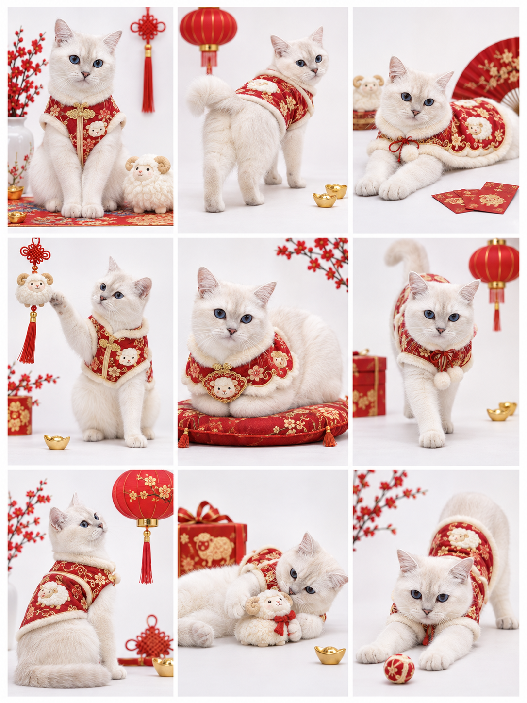
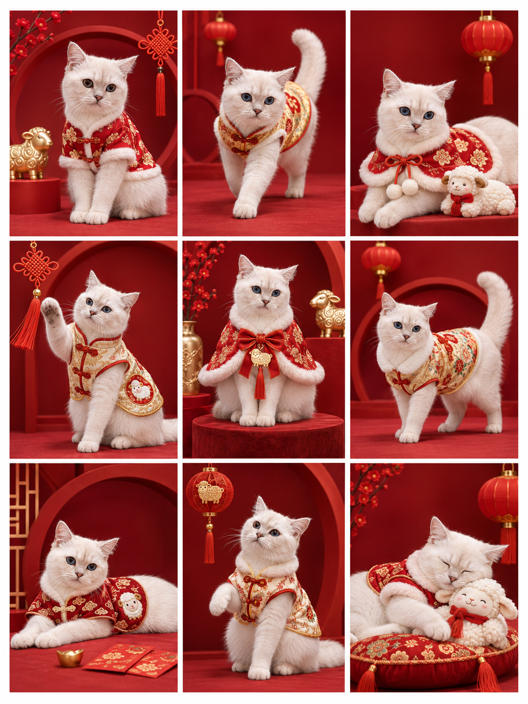
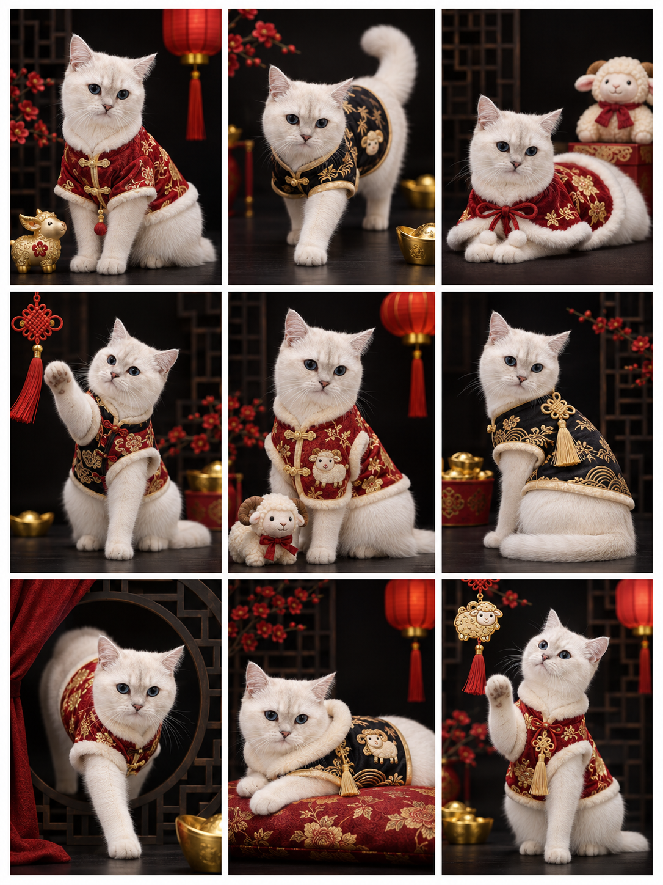
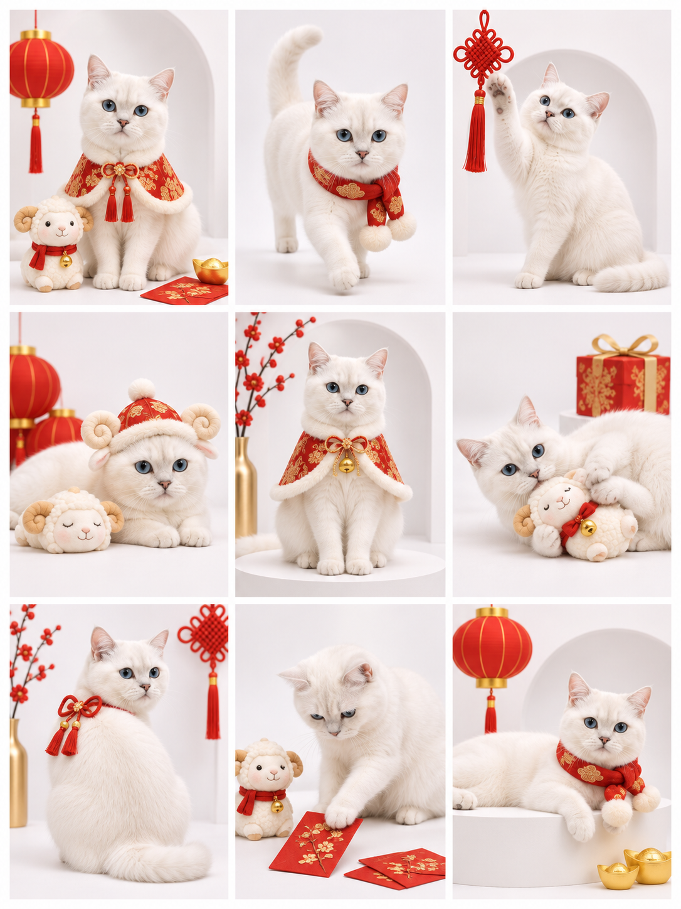

# 🐾 宠物新年写真

[← 返回 Skill 合集首页](../README.md)

上传宠物照片，制作一套风格统一、姿势多样的新年写真。可以指定影棚颜色、节庆道具或生肖主题，也可以先看九宫格预览。

**默认 9 张独立写真** · **3 种影棚背景参考** · **可先看九宫格**

## ✨ 适合做什么

- 根据宠物的参考照片设计春节、新年或生肖主题写真。
- 在不同姿势、景别和道具中保留同一只宠物的可辨识特征。
- 按需先制作九宫格预览，选定方向后再逐张生成独立写真。

## 🖼️ 完整效果展示

四张图均为九宫格预览，依次展示多样姿势、中国红影棚、黑金影棚和纯白影棚。点击图片可查看原图。

| **多样姿势 · 羊年棚拍** | **中国红影棚** |
| :---: | :---: |
|  |  |
| **黑金影棚** | **纯白影棚** |
|  |  |

> 图中羊年元素和猫咪仅为展示示例。九宫格用于预览与选片，并非九张独立成片；独立照片需结合宠物原始参考图逐张生成。

## 🚀 开始使用

**1. 安装 Skill**

按照[统一安装教程](installation.md)获取合集，选择安装 `vane-pet-new-year-portrait`。

**2. 上传宠物照片**

至少提供一张面部清晰的正面或近正面照片；侧面和背面照片可选。可以说明喜欢的背景、服装、道具或生肖主题。例如：

> 使用 $vane-pet-new-year-portrait，根据这张猫咪照片制作新年写真，先给我看一张中国红影棚的九宫格预览。

> 使用 $vane-pet-new-year-portrait，根据这些宠物照片制作九张独立的新年写真，用纯白背景和红色节庆道具。

**3. 确认并生成**

默认逐张生成九张独立写真。若要求先预览，可以选择九宫格中的画面，再结合宠物原始照片逐张生成。指定其他数量或比例时，以你的要求为准。

**4. 检查结果**

核对宠物的脸、眼睛、毛色、自然姿势和新年元素。没有提供的侧面或背面细节可能出现偏差；重新生成的独立照片也可能与预览有细节差异。

## 🛠️ 运行环境与说明

- 需要支持读取宠物参考图的图像生成或编辑工具。
- 默认单张为竖版 3:4；用户要求预览时可先制作整体 3:4 的九宫格。
- 附带脚本仅用于九宫格预览底板的比例处理，需要 Python 3 和 Pillow；不会替代单张写真生成或画面检查。

## 🔍 效果测试与使用边界

四张预览和安装文件的检查情况见[效果测试记录](testing.md)。最终效果取决于参考照片、生成工具及实际结果。

## 📂 Skill 文件

- [Skill 指令](../skills/vane-pet-new-year-portrait/SKILL.md)
- [预览比例处理脚本](../skills/vane-pet-new-year-portrait/scripts/fit_white_canvas.py)
- [统一安装入口](installation.md)
