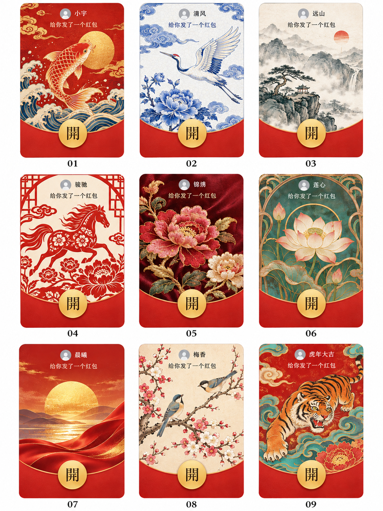
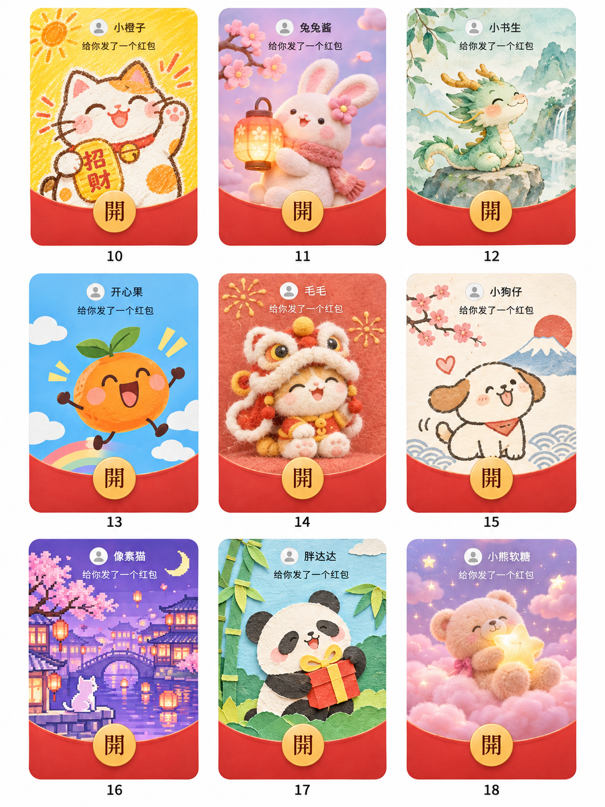
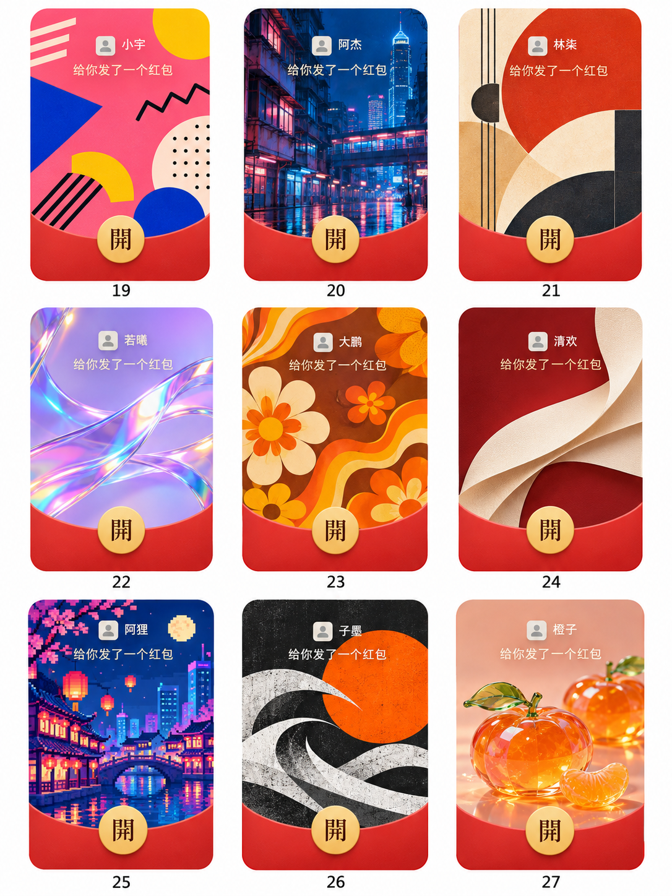
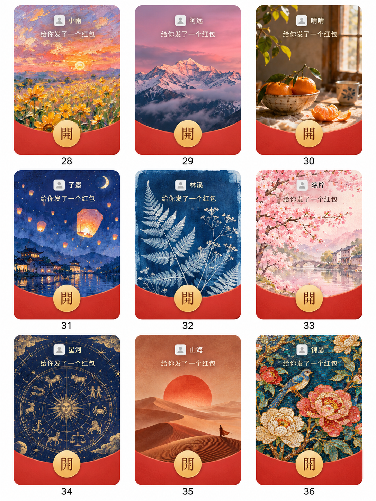

# 🧧 微信红包封面制作

[← 返回 Skill 合集首页](../README.md)

用一句话或参考图片设计专属红包封面。确认原图后，可以查看红包模拟效果，再导出上传图片。

**36 种风格参考** · **4 组完整预览** · **默认单张制作**

## ✨ 适合做什么

- 用人物、宠物或其他参考图制作有个人特色的红包封面。
- 从传统艺术、趣味角色、现代设计和自然艺术中寻找灵感，也可以自定义风格。
- 先确认原图，再查看模拟效果、调整构图并导出图片。

## 🖼️ 完整效果展示

四张九宫格各展示 9 种方向，按编号覆盖 **01—36**。点击图片可查看原图。

| **01—09 · 传统艺术** | **10—18 · 趣味角色** |
| :---: | :---: |
|  |  |
| **19—27 · 现代设计** | **28—36 · 自然艺术** |
|  |  |

> 图片为 AI 生成的风格模拟示例，不是 36 张独立封面原图，也不是微信官方模板；不要直接从预览中裁切上传。各编号名称见 [36 款风格目录](../skills/wechat-red-packet-cover/references/styles.md)。

## 🚀 开始使用

**1. 安装 Skill**

按照[统一安装教程](installation.md)获取合集，选择安装 `wechat-red-packet-cover`。风格参考图和本地处理脚本会一并安装。

**2. 描述你的封面**

告诉它主题、颜色或风格，也可以上传照片、宠物图等参考素材。例如：

> 使用 $wechat-red-packet-cover，为我的橘猫制作一张温暖的新年红包封面，参考 10 号招财猫风格。先给我看封面原图。

**3. 确认原图与模拟效果**

先确认封面画面，再查看模拟红包效果；如果主体被遮挡或构图需要调整，可以继续修改。

**4. 导出并检查**

确认后可导出 957 × 1278 的 JPEG 图片。默认导出会居中裁剪，请检查主体是否完整。模拟预览不能直接作为上传素材；实际上传要求和展示效果请以[微信红包封面开放平台](https://cover.weixin.qq.com/)为准。

## 🛠️ 运行环境与说明

- 生成或修改图片需要可用的图像生成工具；本地导出和模拟预览需要 Python 3 与 Pillow。
- 模拟预览需要可显示中文的字体；没有自动找到字体时，可在脚本中通过 `--font` 指定。
- 示例是风格参考，实际制作默认生成一张新封面；不会自动上传或发布。

## 🔍 效果测试与使用边界

四张预览图及安装、导出流程的检查情况见[效果测试记录](testing.md)。图片内容和最终上传结果仍需自行核对。

## 📂 Skill 文件

- [Skill 指令](../skills/wechat-red-packet-cover/SKILL.md)
- [36 款风格目录](../skills/wechat-red-packet-cover/references/styles.md)
- [原始使用说明与本地命令](../skills/wechat-red-packet-cover/README.md)
- [Skill 许可证](../skills/wechat-red-packet-cover/LICENSE)
