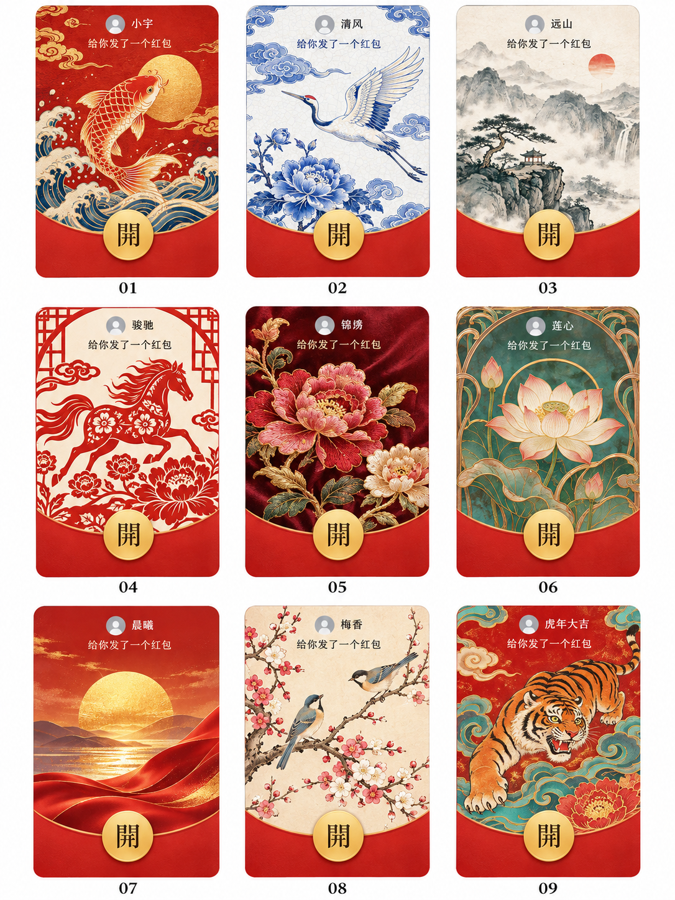
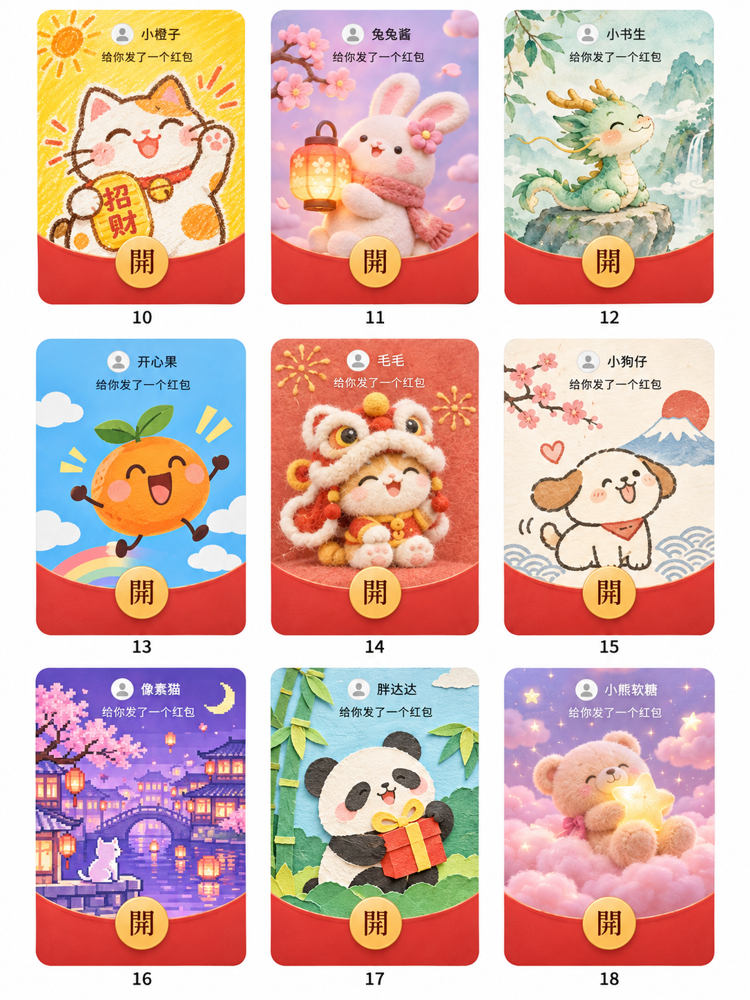
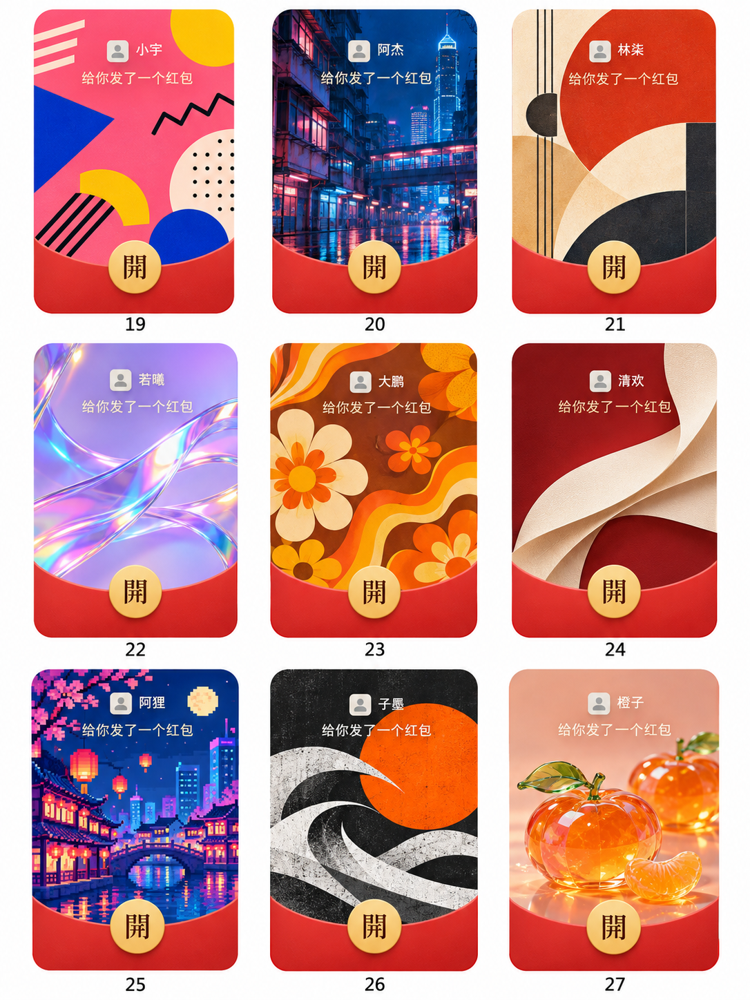
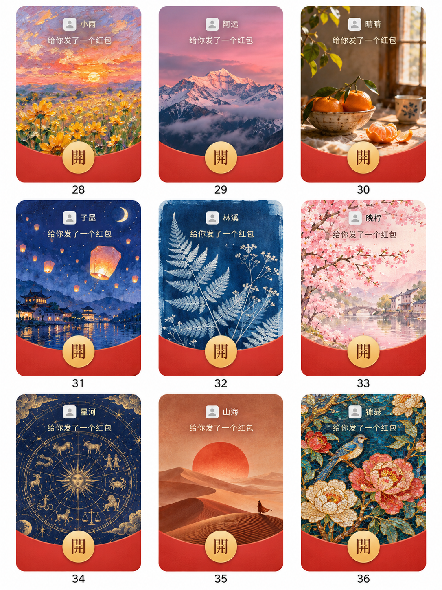

# 微信红包封面制作 Skill

用自然语言或参考图，制作一张专属的微信红包封面。先确认封面原图，再查看模拟红包效果，最后导出适合上传的图片。

## 怎么用

安装后，在支持 Agent Skills 的工具中说：

> 帮我做一张微信红包封面：一只戴红围巾的橘猫，画面温暖，有新年的感觉。

也可以提供人物、宠物或其他参考图，描述想要的画风。默认一次制作一张，流程为：

**描述需求 → 生成原图 → 确认原图 → 查看模拟红包效果 → 确认效果 → 导出成品**

用户可以在确认阶段提出修改。36 款九宫格是展示素材，不会默认作为制作输出。

## 安装

### Codex

下载或克隆本仓库后，将整个 `wechat-red-packet-cover` 目录放入 `~/.codex/skills/`。例如，在仓库的上一级目录运行：

```bash
mkdir -p ~/.codex/skills
cp -R wechat-red-packet-cover ~/.codex/skills/
```

若原位置已有同名 skill，请先检查内容，避免覆盖自己的修改。新安装的 skill 可能需要重新打开聊天或重启应用后发现。

### 其他支持 Agent Skills 的工具

把整个目录放到该工具的 skills 目录，或按照工具的说明加载其中的 `SKILL.md`。图片生成依赖运行环境实际提供的图片生成或编辑能力；本仓库不提供图片生成模型或 API 密钥。

### 图片处理依赖

本地导出和预览需要 Python 3 与 [Pillow](https://pillow.readthedocs.io/)：

```bash
python3 -m pip install Pillow
```

模拟预览还需要能显示中文的本机字体。脚本会尝试查找 macOS、Windows 和常见 Linux 字体；若查找失败，可通过 `--font` 指定中文字体文件。

## 风格参考

四张白底九宫格展示了 36 种视觉方向。编号对应的风格名称见 [风格目录](references/styles.md)；它们是 AI 生成的红包模拟预览，不是 36 张独立封面原图。









## 本地命令

```bash
python3 scripts/cover_tool.py export input.png cover.jpg
python3 scripts/cover_tool.py preview cover.jpg preview.png --name '微信用户' --greeting '恭喜发财，大吉大利'
```

导出命令会居中裁剪到 3:4，并输出 957 × 1278 像素、最多 500,000 字节的 JPEG，不会覆盖输入文件。请检查裁剪是否保留了主体。模拟预览使用本地合成的示意界面，**不是微信官方模板**，具体展示和上传要求请以[微信红包封面开放平台](https://cover.weixin.qq.com/)为准。预览图不能直接作为封面素材上传。

## 目录

```text
wechat-red-packet-cover/
├── SKILL.md                 # Skill 入口与制作流程
├── scripts/cover_tool.py    # 图片导出与模拟预览
├── references/styles.md    # 36 款风格索引
└── assets/style-gallery/   # 四张九宫格展示图
```

## 许可证

MIT，详见 [LICENSE](LICENSE)。
